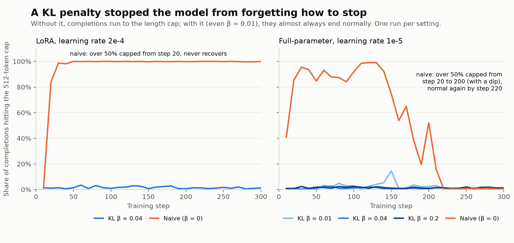
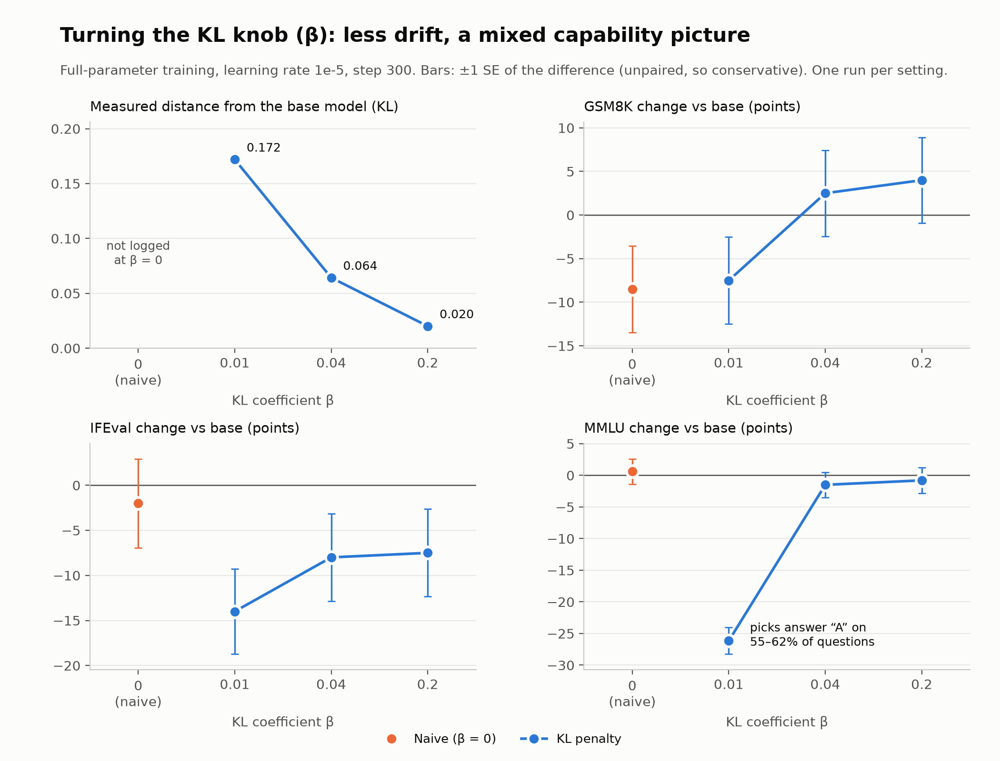
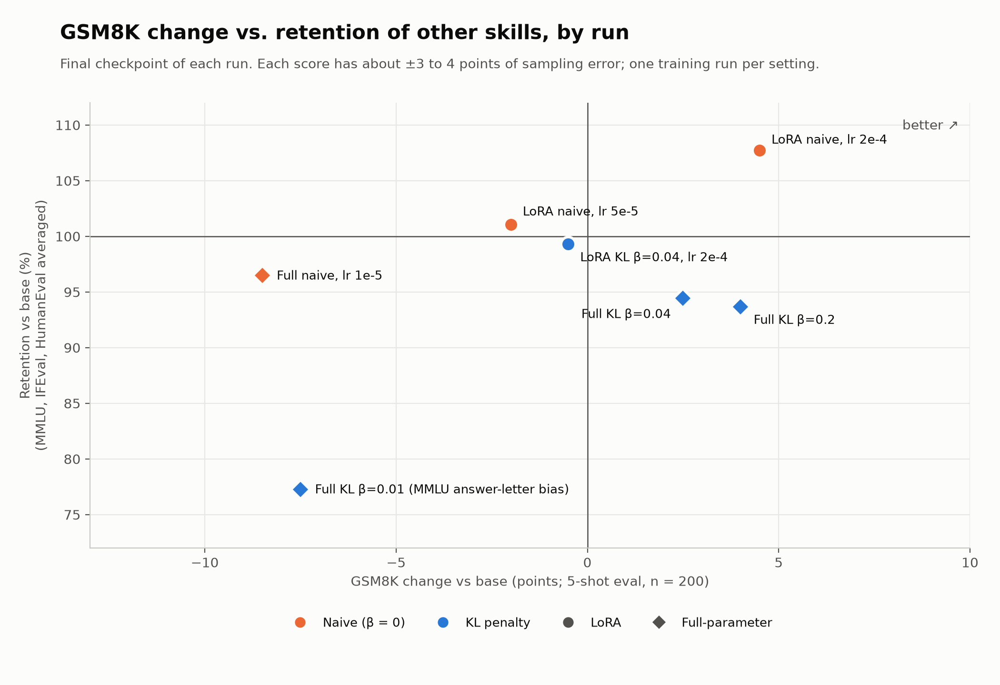

# Measuring the alignment tax of RL post-training

**Question.** When you use RL to teach a model one skill, what does it lose elsewhere, and can a KL penalty control that?

**Setup.** GRPO (TRL) on Qwen2.5-1.5B-Instruct, trained on GSM8K with a verifiable reward, then scored on a fixed battery of held-out tasks. LoRA and full-parameter runs, with and without a KL penalty (`beta`).

**Short answer.** The classic version of the tax, where RL erodes general knowledge, mostly did not appear. What did appear was more specific:

1. A **behavioral collapse** the reward could not see (the model stopped terminating), which a KL penalty prevented at every strength tested.
2. A **loss on the trained task's own few-shot format** in aggressive full-parameter training, which KL also prevented.
3. A **cost that KL did not remove**: instruction-following (IFEval) fell about 8 points in every KL run.
4. One **unexplained anomaly**: the weakest KL setting (`beta = 0.01`) wrecked MMLU through a strong "answer A" bias.

Everything here comes from **one training seed per configuration**, so read the effects as findings from single runs, not established rules. The limits section says exactly what that does and does not support.

---

## Method

| | |
|---|---|
| Model | Qwen2.5-1.5B-Instruct |
| Algorithm | GRPO via TRL 1.14.0, vLLM 0.30.0 for generation (colocated), A100-80GB on Modal |
| Training data | GSM8K train; zero-shot chat prompt that asks for reasoning and a final answer inside `<answer>` tags |
| Reward | Code-only, no learned reward model: `1.0` if the tagged answer matches the ground truth after normalizing `$` and `,`, plus `0.1` for using the tags at all |
| Per step | 16 prompts x 4 completions = 64 completions; 300 steps (about 0.64 of an epoch); completions capped at 512 tokens |
| Runs | LoRA (r=16, all-linear): lr 5e-5 and 2e-4 with `beta = 0`, lr 2e-4 with `beta = 0.04`. Full-parameter, lr 1e-5: `beta` in {0, 0.01, 0.04, 0.2}; plus one full-parameter run at lr 2e-6 that was trained but not scored |

**Evaluation** uses lm-evaluation-harness 0.4.13 with the chat template, batch size 8, and the first 200 documents of each task (fewer where a task has fewer: HumanEval has 164, MMLU government 193): GSM8K (5-shot, flexible-extract), five MMLU subjects chosen to be far from math (US history, biology, philosophy, government and politics, clinical knowledge), IFEval (prompt-level loose), and HumanEval-instruct (pass@1). It is deterministic: the base model scored twice gave identical values on all 30 numeric metrics.

**Retention** is the mean of (run score / base score) over MMLU, IFEval and HumanEval. GSM8K is excluded: it is the trained skill, so it is the gain axis.

## Results







Final checkpoints, n = 200 per task, base model in the first row:

| Run | GSM8K flex | GSM8K strict | MMLU | IFEval | HumanEval | Retention |
|---|---|---|---|---|---|---|
| Base | 0.580 | 0.375 | 0.727 | 0.420 | 0.549 | 100% |
| LoRA naive, lr 5e-5 | 0.560 | 0.385 | 0.733 | 0.425 | 0.555 | 101.0% |
| LoRA naive, lr 2e-4 | 0.625 | 0.530 | 0.733 | 0.500 | 0.567 | 107.7% |
| LoRA KL 0.04, lr 2e-4 | 0.575 | 0.300 | 0.729 | 0.410 | 0.549 | 99.3% |
| Full naive, lr 1e-5 | 0.495 | 0.095 | 0.733 | 0.400 | 0.512 | 96.5% |
| Full KL 0.01 | 0.505 | 0.425 | 0.465 | 0.280 | 0.555 | 77.3% |
| Full KL 0.04 | 0.605 | 0.500 | 0.712 | 0.340 | 0.573 | 94.4% |
| Full KL 0.2 | 0.620 | 0.565 | 0.719 | 0.345 | 0.549 | 93.7% |

The full naive run at intermediate steps: GSM8K flexible 0.43 at step 100, **0.35 at step 200**, 0.495 at step 300. Full per-checkpoint numbers are in `results/summary.csv`.

## What happened

**1. Without a KL penalty, the model forgot how to stop, and the reward never noticed.** The reward checks only that a correct answer appears inside the tags. It does not penalize continuing to generate afterward. The naive LoRA run at lr 2e-4 had over 50% of completions hitting the 512-token cap from step 20 and never recovered. The naive full-parameter run collapsed the same way between steps 20 and 200, then recovered by step 220. Every KL run stayed near zero (worst case 15% at one step for `beta = 0.01`). This is closer to reward hacking by omission than to forgetting, and it is the clearest thing a KL penalty bought.

**2. KL gave a smooth knob.** Measured KL to the base model at the end of training fell from 0.172 to 0.064 to 0.020 as `beta` went 0.01 to 0.04 to 0.2, and entropy rose with it. (KL is not logged at `beta = 0`.)

**3. Where the full-parameter naive run lost ability, it was in the trained task's own format.** Reading its saved generations: at step 200 the outputs contain repetition loops and incoherent self-corrections that run to the length limit, so the last number in the text is usually wrong. The share of answers using the few-shot `####` ending fell from 85% (step 100) to 27% (step 200) to 14% (step 300), replaced by "the answer is ..." phrasing. It did **not** switch to the training `<answer>` tags (0% of outputs). KL runs at `beta >= 0.04` kept the format and ended above base on GSM8K.

**4. KL did not recover instruction-following.** IFEval fell from 0.42 to about 0.34 in the `beta = 0.04` and `0.2` runs (0.28 at `beta = 0.01`), against 0.40 for the naive run. Because IFEval drives the retention average, those KL runs score *lower* retention (94%) than the naive run (96.5%).

**5. Knowledge (MMLU) held in every run except one.** With `beta = 0.01`, MMLU fell to 0.40-0.47. The cause is mechanical: the model picks answer "A" on 55-62% of questions when the true share is about 20%, which sends biology and philosophy to near chance. A healthy KL run (0.04) picks letters evenly. I do not know why the weakest penalty did this while no penalty did not.

**6. LoRA showed no measurable tax,** even at 4x the starting learning rate and with the non-terminating policy. Under the n = 200 evaluation, LoRA at lr 5e-5 did not improve GSM8K (-2 points); an earlier n = 50 reading had suggested +10, which is a good example of how small samples mislead.

## Limits

- **One training seed per configuration.** RL training varies between seeds, and I have no estimate of that variance. Differences between single runs, including the `beta = 0.01` anomaly and the LoRA lr 2e-4 gain (IFEval +8, about 2 standard errors), may be partly seed effects. (The IFEval gain is roughly 1.5 to 2 standard errors.)
- **Sampling error.** Each score has roughly +/-3 to 4 points of standard error at n = 200. The IFEval and HumanEval changes in the naive full run (2-4 points) are inside that.
- **The tasks are the first 200 documents, not a random sample.** This matters: with the first 50 documents the base model's HumanEval was 0.72, against 0.549 on all 164 problems.
- **The gain axis is mismeasured.** GSM8K is scored in lm-eval's few-shot format, but the model was trained zero-shot with `<answer>` tags. Training reward rose a lot while the lm-eval GSM8K score barely moved or fell. Scoring the trained skill in its own format on held-out test questions would fix this; I did not build that.
- **The reward design drives result 1.** There was no penalty for failing to terminate. A reward with a length or termination term would likely remove the collapse for the naive run too, and then the KL comparison would look different.
- **LoRA and full-parameter runs are not matched** (different learning rates, different update capacity), so the two families should not be compared head to head.
- **The lr 2e-6 full-parameter run was trained but not scored** on the accuracy battery.
- **Retention is a single blended number.** It hides which task moved; read the per-task columns.

## Reproducing

Run training and evaluation on Modal (a Volume named `al-tax` holds checkpoints; a Modal secret `wandb-secret` holds the W&B key):

```bash
modal run train.py --run-name full_b0.04_lr1e-5_s300 --beta 0.04 --learning-rate 1e-5 --max-steps 300 --save-steps 100 --full-ft
modal run eval.py --run-name v2_baseline
modal run eval.py --run-name v2_full_b0.04_lr1e-5_s300_ckpt300 --model-id /vol/checkpoints/full_b0.04_lr1e-5_s300/checkpoint-300
```

Then rebuild the table and charts locally (no GPU):

```bash
python aggregate.py   # downloads and caches results, writes results/summary.csv
python charts.py      # writes charts/*.png
```

A full 300-step run took about 35-45 minutes on an A100-80GB; an evaluation about 20-25 minutes on an A10G. Check Modal's pricing for cost.

## Repository

| File | Role |
|---|---|
| `gsm8k_reward.py` | Dataset builder and the two reward functions |
| `grpo_config.py` | LoRA config and `make_training_args` (beta, steps, learning rate) |
| `train.py` | Modal app: GRPO training, checkpoint committing, resume |
| `eval.py` | Modal app: the v2 evaluation (fixed settings, per-question logging) |
| `aggregate.py` | Combines result files into one table; refuses to compare runs with different eval settings |
| `charts.py` | The three charts |
| `results/` | `summary.csv`, cached training curves, and the raw evaluation JSONs behind every number |
| `hello_modal.py`, `volume_demo.py` | Early learning scaffolds, kept for history |

An earlier evaluation setting (n = 50, batch size 1, "v1") was retired once it proved too noisy and unrepresentative; none of the numbers above use it.
